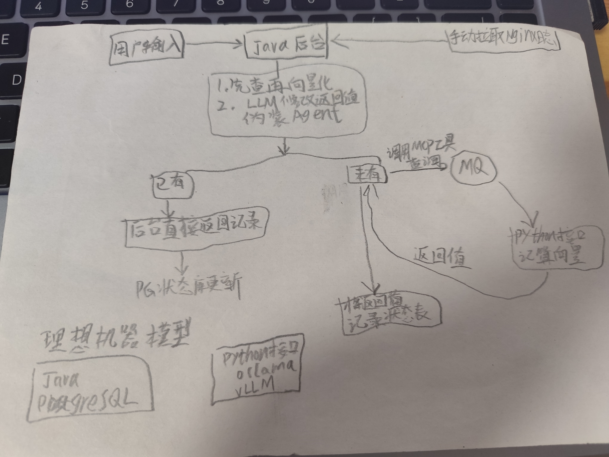
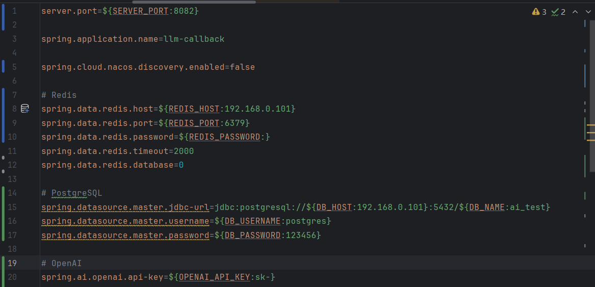
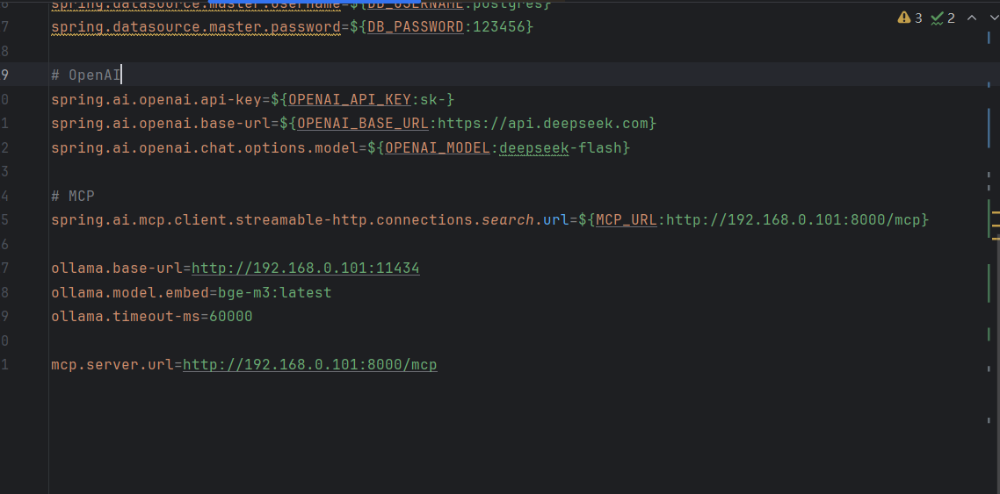

# 智能电影推荐系统（AI-Enhanced Movie Recommender）

## 项目简介
基于多模态向量检索 + 大语言模型编排的个性化电影推荐系统。
解决传统协同过滤的冷启动问题，支持实时偏好更新和多语言语义对齐。

项目的召回、向量存储、LLM编排层设计为通用组件，只需替换数据源和 embedding 模型，即可迁移到任意推荐场景（书籍/商品/岗位等），不需要改架构。

## 技术架构
[画一张图或文字描述：数据流从爬取→向量化→存储→召回→排序→LLM润色]


## 核心技术点

### 1. 多模态向量召回
- 文本：BGE-M3 生成电影简介向量
- 图片：OpenAI CLIP 生成海报向量
- 存储：PostgreSQL + pgvector，hnsw 索引加速
- 检索优化：归一化 + 分片隐藏低层向量

### 2. 冷启动方案
- K-means 聚类将电影分为 5-6 类
- Farthest Point Sampling 选取"差距最大"的 5 部电影作为问卷
- 用户选择后初始化偏好向量

### 3. 实时偏好更新
- 流式处理 Nginx 日志，提取搜索行为
- RabbitMQ 异步更新用户偏好向量（AOP 代理实现）
- 在线 + 离线双路召回，RRF 融合

### 4. LLM 编排层（Java + Spring AI）
- MCP 协议封装翻译工具，LLM 智能决定是否调用
- Spring AI Advisor 拦截链实现：结构化输出 → 前端润色
- 降级策略：本地 DB 未命中 → 网络接口兜底

### 5. 评估与实验
- 留 10% 数据作为测试集，按 session 分组 A/B 实验
- 指标：HR@10、NDCG
- 对照实验：bg25 vs bge-m3 vs bge-m3+instruct

## 实验结果
| 模型 | HR@10 | 说明 |
|---|---|---|
| bg25（英文缩减版） | 0.94 | 文本检索基线 |
| bge-m3 中文原文 | 0.54 | 多语言语义对齐有损 |
| bge-m3 + instruct | 0.48 | 中文简介过短，instruct 反而引入噪声 |

> 结论：中文电影简介文本质量限制了多语言 embedding 的效果，后续可通过扩充简介长度或混合语言训练改善。

## 项目亮点
- MCP + Spring AI Advisor 实现 AI 工具调用的解耦与复用
- 冷启动用 FPS 算法选最远点，保证问卷覆盖度
- 离线评估：采用自检索（Self-Retrieval）方式验证 embedding 模型质量。对 50 部电影分别用中文原文、英文翻译、加 instruct 三种 query 方式检索，统计命中率（HitRate@50）。
- 多路召回 + 降级策略，保证服务可用性

## 待改进
- 中英文对齐效果有待提升
- 并发处理：MCP 工具当前单实例，后续可通过环境变量注入多 key + 负载均衡
- 推荐多样性：当前未显式控制

## docker 发布
在release里有发布文件，对应的yml图片如下，启动时应该先启动search.py，即mcp服务，还需要postergresql数据库、redis单体、ollama单机等服务。test_clip是图片计算服务，rabbitmq主要是批处理，这两个不启动不会影响服务。ollama需要安装bge-m3.





下边提供参考的docker-compose.yml：
```yaml
services:
  postgres:
    image: postgres:16-alpine
    container_name: llm-postgres
    restart: unless-stopped
    environment:
      POSTGRES_DB: llm_callback
      POSTGRES_USER: llm
      POSTGRES_PASSWORD: llm123456
      TZ: Asia/Shanghai
    ports:
      - "5432:5432"
    volumes:
      - pgdata:/var/lib/postgresql/data
    healthcheck:
      test: ["CMD-SHELL", "pg_isready -U llm -d llm_callback"]
      interval: 5s
      timeout: 3s
      retries: 10

  redis:
    image: redis:7-alpine
    container_name: llm-redis
    restart: unless-stopped
    command: redis-server --appendonly yes --bind 0.0.0.0
    ports:
      - "6379:6379"
    volumes:
      - redisdata:/data
    healthcheck:
      test: ["CMD", "redis-cli", "ping"]
      interval: 5s
      timeout: 3s
      retries: 10

  ollama:
    image: ollama/ollama:latest
    container_name: llm-ollama
    restart: unless-stopped
    ports:
      - "11434:11434"
    volumes:
      - ollamadata:/root/.ollama

  mcp-search:
    build:
      context: ./mcp_server
      dockerfile: Dockerfile
    container_name: lcp-search
    restart: unless-stopped
    command: ["python", "search.py"]
    ports:
      - "8001:8001"
    healthcheck:
      test: ["CMD", "python", "-c", "import urllib.request,sys; sys.exit(0 if urllib.request.urlopen('http://localhost:8001/health', timeout=2).status==200 else 1)"]
      interval: 3s
      timeout: 3s
      retries: 20
      start_period: 5s

  llm-callback:
    image: llm-callback:1.0
    container_name: llm-callback
    restart: unless-stopped
    depends_on:
      postgres:
        condition: service_healthy
      redis:
        condition: service_healthy
      ollama:
        condition: service_started
      mcp-search:
        condition: service_healthy
    environment:
      SPRING_DATA_REDIS_HOST: redis
      SPRING_DATA_REDIS_PORT: "6379"
      SPRING_DATA_REDIS_PASSWORD: ""

      SPRING_DATASOURCE_URL: jdbc:postgresql://postgres:5432/llm_callback
      SPRING_DATASOURCE_USERNAME: llm
      SPRING_DATASOURCE_PASSWORD: llm123456

      OLLAMA_BASE_URL: http://ollama:11434
      OLLAMA_MODEL_EMBED: bge-m3:latest

      SPRING_AI_OPENAI_BASE_URL: https://api.deepseek.com
      SPRING_AI_OPENAI_API_KEY: sk-你的deepseek-key
      SPRING_AI_OPENAI_CHAT_OPTIONS_MODEL: deepseek-chat

      MCP_SERVER_URL: http://mcp-search:8001
      SPRING_CLOUD_NACOS_DISCOVERY_ENABLED: "false"
      TZ: Asia/Shanghai
    ports:
      - "8082:8082"

volumes:
  pgdata:
  redisdata:
  ollamadata:
```

## 最终评价
本产品旨在成为站长所使用模板站的轻量级挂件，也具有衍化成单独产品的可能，比如成为用户或平台的AI宠物，根据使用痕迹进行个性化推荐和交流。
